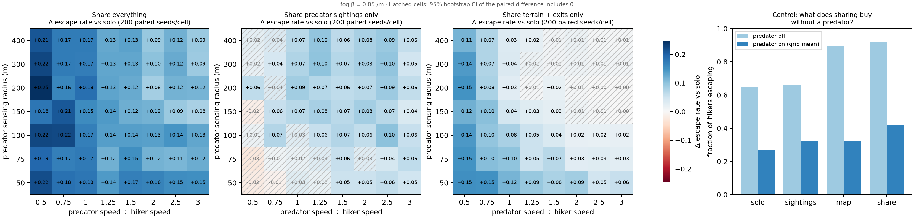
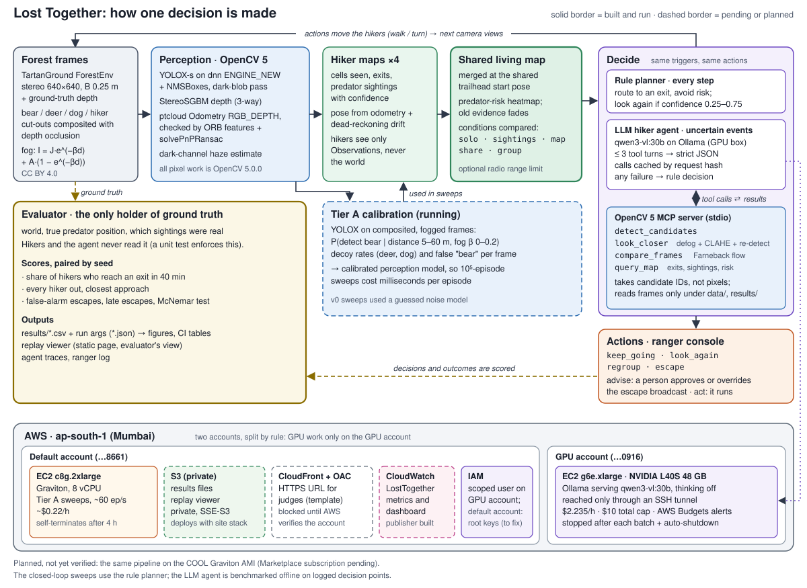

# Lost Together

**A pre-registered simulation study on OpenCV 5 and AWS: do lost hikers who share a living map made from their own camera views escape a hunting predator more often than hikers who act alone?**

Lost hikers each see the forest only through their own camera, and something is hunting them. The same question applies to any group lost while a hazard moves toward it: wildfire, rising water, a bear. In our simulation, sharing a map built from what each hiker sees raised the share of hikers who escaped from **26.8%** to **42.4%** (clear air, perception calibrated from our OpenCV 5 pipeline). The benefit shrank as the predator got faster (from +21 points at half the hikers' speed to +12 points at three times their speed) but did not disappear anywhere in the tested grid. In fog it shrinks by a third (+15.6 points in clear air, +10.4 at about 39 m visibility) yet stays above zero in all 56 cells, so within the fog we tested there is no point where sharing stops helping.

| Tier A v1 at a glance (calibrated perception) | |
|---|---|
| Episodes simulated, all paired by seed | 159,800 (134,400 grid, covering 3 fog levels, + 22,400 group-vs-share + 3,000 predator-off control), plus the 44,800-episode perfect-perception reference from v0, which current code reproduces row for row |
| Cells where full sharing beats solo (95% CI above 0) | 56 of 56, at each of 3 fog levels |
| Gap to perfect perception recovered by sharing | 56% (v0's guessed model said 81%) |
| Predictions that held / partly held / were partly falsified | 3 / 1 / 1 (H3, reported below) |
| Cost of the 134,400-episode v1 sweep on one Graviton c8g.2xlarge | 1,399 s, about $0.08 at $0.216/h |

> **Status, 2026-10-26.** Every number on this page is from a **simulation**. The Tier A numbers come from **v1**, whose perception model is measured from our OpenCV 5 pipeline (YOLOX on composited, fogged TartanGround frames). The earlier v0 dress rehearsal used a guessed model; its numbers are kept in [RESULTS.md](RESULTS.md). The full-pixel runs (Tier B) have not been run yet. The live LLM agent (Tier C) has been benchmarked against the rule on 360 decision moments: it is not significantly more accurate, and it is worse in thick fog. See [RESULTS.md](RESULTS.md) for the log.



*Tier A v1 (perception calibrated from the OpenCV pipeline), light fog β = 0.05 (≈ 78 m visibility). 56 cells × 200 paired seeds per condition. Each cell shows how much the escape rate changes compared with hikers acting alone. Hatched cells have a 95% bootstrap CI that includes 0. Right panel: the predator-off control. Regenerate the figure with `uv run python -m lost_together.figures results/tierA_v1.csv --control results/tierA_v1_off.csv --beta 0.05`.*

### What judges should look at (5 minutes)

| # | Look at | Why |
|---|---|---|
| 1 | [The headline figure](docs/img/headline.png) and [RESULTS.md](RESULTS.md) | Where sharing helps, and by how much. Every prediction is shown with its verdict, including the one we got partly wrong (H3). |
| 2 | [PREREGISTRATION.md](PREREGISTRATION.md) | The predictions were written down before the main runs. SHA-256 `790902a3…` (full hash [below](#experiment-design)). |
| 3 | [docs/architecture.svg](docs/architecture.svg) | One picture of the whole system: perception, maps, decisions, the agent, the evaluator and AWS. |
| 4 | [`lost_together/vision/`](lost_together/vision/) and [docs/img/fog_strip.jpg](docs/img/fog_strip.jpg) | The OpenCV 5 pipeline: YOLOX on the new DNN engine, StereoSGBM, ORB + `solvePnPRansac` odometry (the dense `ptcloud` odometry failed on foliage, and the PnP gate catches it), and depth-aware fog compositing. |
| 5 | [`lost_together/agent/`](lost_together/agent/) | An OpenCV 5 MCP tool server, a look-again agent loop with a rule-based fallback, and a ranger console with an autonomy dial. |
| 6 | Replay viewer: `python -m http.server -d viewer 8000`, then open <http://localhost:8000/?hiker=4&reveal=end&play=1> | The same seed run solo and with a shared map, side by side. Hosted copy: {{TBD: public viewer URL}} |
| 7 | [infra/aws/README.md](infra/aws/README.md) | Cloud delivery, costs, security headers, teardown. |
| 8 | Video: {{TBD: video link}} | Two minutes, following [docs/VIDEO_SCRIPT.md](docs/VIDEO_SCRIPT.md). |

---

## How it works



1. **Perception (OpenCV 5.0.0).** Hikers look at real-looking forest frames from TartanGround ForestEnv: a 640×640 stereo pair with a 0.25 m baseline and ground-truth depth. We composite a bear, deer, a dog or another hiker into the frames at a metric distance, hide the pixels that the ground-truth depth says are occluded, and add fog with the scattering model I = J·e^(−βd) + A·(1 − e^(−βd)). Each hiker then detects candidates with YOLOX-s on the OpenCV 5 DNN engine (`ENGINE_NEW`), estimates depth with `StereoSGBM`, and tracks its own motion with ORB features and `solvePnPRansac`. Dense `ptcloud` RGB-D odometry runs alongside and is used only when PnP agrees with it; on our forest frames with ground-truth depth it rarely did (the gate kept 7 of 120 dense estimates) (see [Vision pipeline checks](#vision-pipeline-checks-preliminary-from-results)). This pixel pipeline is what calibrates the noise model used in the large sweeps (see **Honest scope** below).
2. **Per-hiker maps.** Each hiker keeps the cells it has seen, the exits it knows about, and predator sightings with a confidence. Hikers receive only `Observation`s, never the world itself. A unit test (`tests/test_sim.py::test_hiker_policy_never_touches_ground_truth`) enforces this.
3. **Shared living map.** The maps merge because all hikers start at the same trailhead pose. Predator evidence becomes a risk heatmap that fades over time, which is what makes the map "living". We compare five conditions: `solo` (no sharing), `sightings` (predator sightings only), `map` (terrain and exits only), `share` (everything), and `group` (share, then walk together after a majority vote).
4. **Decisions.** A rule-based planner runs every step. It routes each hiker to an exit while avoiding risk, and looks again when a sighting's confidence is between 0.25 and 0.75.
5. **Agent.** On uncertain events, an LLM hiker agent (`qwen3-vl:30b-a3b-instruct`, self-hosted with Ollama on an AWS GPU) can spend up to three tool turns on OpenCV 5 tools served by **one MCP server**:
   - `detect_candidates`
   - `look_closer`: crop, dark-channel defog, CLAHE, zoom and re-detect;
   - `compare_frames`: Farneback flow with the camera's own motion removed. Animals move; rocks do not;
   - `query_map`.

   The agent refers to candidates by ID, never by pixel coordinates. It answers in strict JSON with one of `keep_going`, `look_again`, `regroup` or `escape`. Every failure falls back to the rule decision and records the reason. These failures include a timeout, invalid JSON, an unknown tool, a bad argument, an exhausted tool budget and a missed deadline.
6. **Human control.** In `advise` mode, an `escape` decision (an evacuation broadcast) waits for a ranger to approve or override it. In `act` mode it runs directly and is logged for audit.
7. **Evaluator.** A separate evaluator is the only component that holds ground truth: the world, the predator's position, and which sightings were real. It scores:
   - the share of hikers who reach an exit within 40 simulated minutes;
   - whether every hiker got out;
   - the predator's closest approach;
   - false-alarm escapes and late escapes.

**Honest scope.** The 10⁵-episode sweeps run on a 2D grid world: 80×80 cells of 5 m, with 4-second steps. In that world, perception is replaced by a noise model. In v0 that model was guessed. In v1 it is fitted to YOLOX detection rates on composited, fogged TartanGround frames. The full-pixel "viewpoint graph" simulator (Tier B) is designed in [PROJECT_BRIEF.md §4](PROJECT_BRIEF.md) but has not been run yet.

### Requirements table: OpenCV 5 API → what it does here

Only APIs that the code actually calls are listed (`grep -rn "cv2\." lost_together tools`). No PyTorch and no ONNX Runtime: the detector runs entirely on OpenCV's DNN module. Pose-graph optimisation with GTSAM is planned but **not built**.

| OpenCV 5 API | What it does here | Where | Measured time | % of per-frame time |
|---|---|---|---|---|
| `cv2.dnn.readNetFromONNX(path, cv2.dnn.ENGINE_NEW)` | Runs YOLOX-s from OpenCV Zoo (COCO, Apache-2.0) on the new DNN engine. The engine gives identical detections to `ENGINE_CLASSIC` (`tools/yolox_check.py`). Finds bears, people, and decoy-class animals. | `vision/detector.py`, `vision/calibrate.py`, `agent/tools.py` | YOLOX 693 ms per frame; full detection with the blob pass 893 ms (`results/bench_stock_graviton.json`, Graviton4, 1 thread; 125 / 244 ms at 8 threads) | 69% (YOLOX), 89% (detection) |
| `cv2.dnn.NMSBoxes` | Class-aware non-maximum suppression: boxes are offset by class before NMS. | `vision/detector.py` | incl. above | incl. above |
| `cv2.StereoSGBM_create(..., mode=MODE_SGBM_3WAY)` | Depth from the stereo pair: 128 disparities, block 5, P1 = 8·cn·b², P2 = 32·cn·b². Depth = f·B/(disp/16). | `vision/stereo.py` | 70.5 ms median per 640×640 pair on Graviton4, 1 thread; 20.4 ms at 8 threads (`results/bench_stock_graviton.json`). The earlier laptop run logged 332 ms (`results/vision_stereo.json`). | 7% |
| `cv2.Odometry(cv2.OdometryType_RGB_DEPTH, cv2.OdometrySettings, cv2.OdometryAlgoType_COMMON)` (`ptcloud`) | Dense frame-to-frame RGB-D odometry. Settings: float32 K, max depth 25 m, motion limits scaled to a 10 Hz walking step. | `vision/odometry.py` | not timed (offline odometry evaluation) | not in the per-frame loop |
| `cv2.ORB_create`, `cv2.BFMatcher(cv2.NORM_HAMMING).knnMatch` (`features`) | Keypoints and ratio-test matches used to check odometry. | `vision/odometry.py` | not timed (offline odometry evaluation) | not in the per-frame loop |
| `cv2.solvePnPRansac`, `cv2.solvePnPRefineLM`, `cv2.Rodrigues` | Motion from 3D–2D matches (RANSAC, then Levenberg–Marquardt refinement on the inliers). It gates the dense estimate, because the Odometry success flag is not a validity check. | `vision/odometry.py` | not timed (offline odometry evaluation) | not in the per-frame loop |
| `cv2.erode`, `cv2.dilate` | Erode: the min filter for the dark-channel prior. Dilate: fill holes during compositing. | `agent/tools.py`, `vision/composite.py` | small | part of render (42 ms, 4%) and detection |
| `cv2.calcOpticalFlowFarneback` | `compare_frames`: motion inside a candidate box minus the frame's median flow, which is the camera's own motion. | `agent/tools.py` | 17.3 ms per `compare_frames` call (`results/bench_stock_graviton.json`, Graviton4, 1 thread) | agent tool, only on escalations |
| `cv2.createCLAHE` (on the Lab L channel), plus dark-channel defog | `look_closer` enhancement. The same dark channel gives each frame's haze and visibility estimate. | `agent/tools.py` | 698 ms per `look_closer` call, dominated by the YOLOX re-detect (`results/bench_stock_graviton.json`, Graviton4, 1 thread) | agent tool, only on escalations |
| `cv2.GaussianBlur`, `cv2.subtract`, `cv2.threshold`, `cv2.morphologyEx`, `cv2.findContours`, `cv2.contourArea`, `cv2.convexHull`, `cv2.boundingRect`, `cv2.drawContours`, `cv2.mean` | A classical "dark blob" pass. It surfaces shapes YOLOX misses as `unknown` candidates, so ambiguous shapes reach the agent instead of being dropped. | `agent/tools.py` | ≈ 200 ms with the haze estimate (detection 893 ms − YOLOX 693 ms, Graviton4, 1 thread) | ≈ 20% |
| `cv2.grabCut` (`GC_INIT_WITH_RECT` / `GC_INIT_WITH_MASK`), `cv2.connectedComponentsWithStats`, `cv2.floodFill` | Cuts the animals and hikers out of licensed photos. Runs offline, once. | `vision/cutouts.py` | offline | n/a |
| `cv2.resize` (`INTER_AREA` / `LINEAR` / `CUBIC`) | Scales cut-outs to metric size, letterboxes to 640, zooms crops. | several | small | part of render and detection |
| `cv2.applyColorMap(COLORMAP_TURBO)`, `cv2.imencode` / `cv2.imdecode` | Depth visualisation. PNG/JPEG images returned as MCP image content. | `vision/stereo.py`, `agent/tools.py`, `agent/mcp_server.py` | small | not in the per-frame loop |

### AWS service → role → cost

Both accounts are in **ap-south-1 (Mumbai)**. The team's rule keeps all GPU work on a separate account.

| AWS service | Role | Cost |
|---|---|---|
| **EC2 c8g.2xlarge** (Graviton, 8 vCPU, default account) | Tier A sweeps at about 60 episodes/s (`tools/sweepbox.sh up / sync / run / fetch / down`). SSH is open only to the team's IP. IMDSv2 is required. The instance terminates itself after 4 h. It uses the stock Ubuntu 24.04 arm64 AMI with the `opencv-python==5.0.0.93` wheel, **not** COOL. | ~$0.22/h. `tierA_v0` (56,000 episodes) took 743 s, about **$0.05**. `tierA_ref` (44,800 episodes) took 833 s, about **$0.05**. |
| **EC2 g6e.xlarge** (NVIDIA L40S 48 GB, GPU account) | Ollama serving `qwen3-vl:30b-a3b-instruct` (no thinking), behind an OpenAI-compatible API. It is reached only through an SSH tunnel; port 11434 is never opened. Each session runs one batch and then stops, and a shutdown timer in user-data acts as a safety net. The launch steps are in `CLAUDE.md`; the launch script is `tools/gpubox.sh` (`up`, `tunnel`, `status`, `down`). | $2.235/h. **$10 total cap.** The AWS Budget `lost-together-gpu-cap` emails alerts at 50/80/100% plus a forecast alert. Budgets alert but do not stop instances, so the cap relies on stop-after-batch and the auto-shutdown. Spend so far: about $2.6 of instance time (estimated from instance minutes; the Budget is the authority). Planning estimate for Tier C ([PROJECT_BRIEF.md](PROJECT_BRIEF.md) §7): about 2,000 calls, 70 GPU-minutes, about $2.60. |
| **S3** | A private bucket (all Block Public Access flags on, SSE-S3, TLS-only bucket policy) for the replay viewer and the `results/` files. It is defined in the same template as CloudFront, so it is deployed together with it. Deployment status: {{TBD}}. | < $0.01/month |
| **CloudFormation + CloudFront** (`infra/aws/site.yaml`) | An HTTPS URL for judges. Origin Access Control, HSTS and a strict CSP. Framing and device APIs are turned off. **Blocked:** the default account cannot create CloudFront distributions until AWS Support verifies the account. The fallback is a plain S3 website (`infra/aws/deploy_s3_website.sh`), which the team runs itself. | $0 within the free tier |
| **CloudWatch** | `infra/aws/publish_metrics.py` publishes per-sweep metrics and a `LostTogether` dashboard: escape rate, paired Δ vs solo with a 95% CI, cells where a mode helps or hurts, false alarms, and hikers intercepted. It does a dry run unless given `--apply`. Published so far: {{TBD}}. | ≈ $0.01–0.05 per sweep published |
| **IAM** | A scoped developer user (`infra/iam/`), in use on the GPU account: PowerUserAccess without IAM administration. IAM writes are limited to `lost-together-*` roles and policies, with an explicit deny on attaching admin policies. The same scoped user `lost-together-dev` now exists on the default account, and the agent box runs as it. The site and metrics scripts refuse to run outside the expected account. There are no secrets in the repo. | $0 |
| **AWS Budgets** | The GPU spend cap and alerts (see the g6e row). | $0 |

**COOL (Cloud-Optimized OpenCV Library):** not used, and this entry does not compete for the Best Use of COOL award. Running COOL needs a paid AWS Marketplace subscription, which we did not take. The stock-OpenCV Graviton benchmark (RESULTS.md) is reported as a plain performance baseline, not as a COOL comparison.

---

## Experiment design

| Tier | What | Scale | Status |
|---|---|---|---|
| **A** (phase diagram) | Grid of predator speed ÷ hiker speed (0.5–3) × sensing radius (10–80 cells, 50–400 m). Five cooperation conditions × 200 paired seeds. Plus a predator-off control and a perfect-perception reference. | 56,000 + 44,800 + 1,000 episodes (v0); 134,400 + 22,400 + 3,000 (v1) | v0 done (guessed perception). **v1 (calibrated) done**: see Results. |
| **B** (full pixels) | Three anchor cells × 3 conditions × 100 seeds, with perception from pixels. Checks the surrogate against the pixel runs. | 900 episodes | Not run |
| **C** (rule vs LLM) | Both policies decide on the same logged decision points. Scored against the evaluator with McNemar's test. Ablation: the LLM gets only scalar features (no image, no tools). | 360 points (+100 ablation) | **Done.** No significant accuracy difference (p = 0.39); fewer false alarms, more late escapes. |

- **Pre-registration.** [PREREGISTRATION.md](PREREGISTRATION.md) was written at 17:38 UTC on 2026-10-26, before any main run. SHA-256: `790902a39a406c780cd20b03725d38f91574a45448b38548a3abb853e8be804f`. It was committed as `05e5a12` ("Pre-register predictions for the main sweeps"), the first commit in the repository, at 18:26 UTC: after the v0 dress-rehearsal sweep (17:38–17:50) but before the calibrated v1 sweeps (from 19:32). For v0 the 17:38 timestamp is self-reported; for v1 the commit itself predates the run. The pilot sweeps (seeds 0–119) only chose parameter ranges; the main runs use fresh seeds starting at 1000.
- **v1 note.** v1 reuses the v0 seeds and analysis unchanged. The team has seen the v0 results, so neither the predictions nor the analysis may change for v1.
- **Paired seeds (common random numbers).** Each seed fixes the forest, the spawn points, the exits and the predator's start, identically across conditions, with separate random streams for each. Every contrast is a paired difference with a 95% bootstrap CI per cell.
- **Predator-off control.** This separates "the shared map helps find the exit" from "the shared map helps avoid the threat".
- **Perfect-perception reference.** Same field of view, same line of sight, same planner, but perfect self-pose and perfect labels for anything in view. It is a reference, not an upper bound.

## Results (Tier A v1: calibrated perception)

Clear air unless stated; fog β = 0.05 and 0.1 per metre correspond to about 78 m and 39 m visibility. All
numbers are from `results/tierA_v1_report.json`.

| Prediction | Verdict (v1) |
|---|---|
| **H1.** `share` beats `solo` in most of the grid | **Holds.** 56/56 cells have a CI above 0 at every fog level. Mean Δ = +0.156 (escape rate 26.8% → 42.4%); +0.148 at β = 0.05; +0.104 at β = 0.1. |
| **H2.** The benefit shrinks as the predator gets faster and senses further | **Partly holds.** It shrinks with speed, from +0.21 at 0.5× to +0.12 at 3× (column means), but only slightly with sensing range (+0.17 at 50 m, +0.15 at 400 m). It **never reaches zero** in this grid; the weakest cell is +0.095 in clear air and +0.039 [+0.016, +0.064] at β = 0.1. |
| **H3.** Sharing *sightings alone* helps in an intermediate band (speed ≈ 1–2×, radius ≈ 15–40). It does not help against a slow predator or one that senses the whole forest. With the predator off, `sightings` ≈ `solo`. | **Partly falsified.** The control holds: with no predator, +0.025 [−0.020, +0.070]. As predicted, sightings do not help against a slow predator (0.5×: 0/7 cells above 0). **Contrary to the prediction, they keep helping when the predator senses the whole forest** (400 m: 6/8 cells above 0), and the band is wide: 39/42 cells at ≥ 1× are above 0. Overall 41/56 cells above 0, none below. |
| **H4.** Imperfect vision costs escapes (`calibrated` < `perfect`) | **Holds, more strongly than v0 guessed.** 208/224 mode × cell comparisons are below 0 and none above (mean −0.10 to −0.18 by mode; v0: −0.049). The detector finds the bear only out to about 15 m. |
| **H5.** Moving as a group does not beat sharing without grouping | **Holds.** `group` is below `share` in 44/56 cells and above in none (mean −0.073). Groups are easier to sense and lose time gathering. |

- **Gap recovered by sharing:** (V_share − V_solo) / (P_share − V_solo) = **0.56** (0.54 at β = 0.05, 0.35 at β = 0.1). With measured vision, sharing recovers about half of what perfect perception would give. v0's guessed model said 0.81.
- **Fog.** Light fog (78 m) changes almost nothing, because the detector's reach is already shorter than the visibility. At 39 m the sharing benefit falls by a third. Shared terrain and exits are fog-proof (+0.054 at every level); what fog erodes is the value of shared sightings (+0.059 → +0.034).
- **What the control says about full sharing.** With the predator off, `share` gets 93.1% of hikers out against 64.9% for `solo`, and `map` alone gets 89.0% (`results/tierA_v1_off.csv`). Much of the full-sharing benefit comes from finding exits. The threat-specific part travels through shared sightings, and only matters once the predator is at least as fast as the hikers.

### Robustness (v0 perception, 3 × 2 anchor grid, seeds 1000–1199)

- **Ambush predator** (it waits near an exit): `share` − `solo` stays positive, +0.12 to +0.28, with every CI above 0.
- **Radio range limit**: the benefit shrinks with range:
  - 50 m: +0.05 to +0.10;
  - 100 m: +0.08 to +0.13;
  - global sharing: +0.12 to +0.27.

  Every CI is above 0. A shared map is worth as much as the hikers' ability to talk.

### Vision pipeline checks (preliminary, from `results/`)

- **StereoSGBM vs ground-truth depth** (20 TartanGround frames, pixels closer than 20 m; `results/vision_stereo.json`):
  - clear air: 78% of pixels valid, median error 0.10 m (2.0% relative), 22% of valid pixels off by more than 10%;
  - densest fog tested (β = 0.2, visibility ≈ 20 m): 81% valid, median error 0.11 m.

  Fog barely moves SGBM error here, because the fog model is smooth and noise-free. Adding sensor noise (σ = 2 grey levels) changes little.
- **Odometry** (121 frames of ForestEnv P0004; `results/vision_odometry.log`, final run). Depth is either ground truth or our SGBM stereo; drift is end-point error as % of path length, ATE after alignment:

  | Depth source | Dense `ptcloud` RGB-D alone | ORB + `solvePnPRansac` | Dense gated by PnP |
  |---|---|---|---|
  | Ground-truth depth | 88.5% / 11.7 m | 12.2% / 0.85 m | 11.1% / 0.84 m |
  | SGBM stereo, clear | 102.3% / 10.2 m | 20.3% / 0.95 m | 20.4% / 0.96 m |
  | SGBM, fog β = 0.05 | 108.1% / 8.9 m | 16.3% / 1.31 m | 17.0% / 1.34 m |
  | SGBM, fog β = 0.05 + noise σ = 2 | 114.7% / 9.2 m | 28.3% / 1.22 m | 29.3% / 1.31 m |
  | SGBM, fog β = 0.1 | 104.4% / 8.1 m | 15.5% / 1.08 m | 15.5% / 1.09 m |

  On these frames `Odometry.compute` returns success with a plausible rotation but a translation of about 10⁻⁴ m for a 0.42 m step (see the docstring of `lost_together/vision/odometry.py`). So dense RGB-D odometry fails here, the PnP gate rejects most dense estimates (it kept 5–11 of 120), and PnP is the primary estimator. Real stereo depth roughly doubles PnP drift relative to ground-truth depth; fog does not make it worse on this smooth, noise-free fog model.
- **Detection, one illustrative frame** ([docs/img/fog_strip.jpg](docs/img/fog_strip.jpg)). Bear at 10 m:
  - "bear 0.82" in clear air;
  - "bear 0.71" at β = 0.05 (visibility 78 m);
  - mislabelled "elephant 0.35" at β = 0.1.

  At 30 m there is no detection in any fog. A 3× look-closer tile of a bear at 20 m is detected in clear air (0.81) but not in fog. This is a single example, not a rate. Calibrated detection rates (YOLOX, score ≥ 0.25, `results/calibration.json`): 0.97 at 5 m, 0.80 at 10 m, 0.04 at 15 m and 0 from 20 m in clear air (0.96 / 0.74 / 0.05 / 0 at β = 0.1). The 3× zoom (`results/calibration_zoom.json`, an upper bound by up to about 0.08) reaches 0.88 at 20 m and 0.16 at 30 m in clear air, and 0.41 at 20 m at β = 0.1. Plots: `results/vision_pdetect.png`, `results/vision_pdetect_zoom.png`.
- **Cut-out sanity check** ([docs/CUTOUT_SOURCES.md](docs/CUTOUT_SOURCES.md)). On a flat grey background, YOLOX labels all three bears "bear" (0.84–0.97). It labels the deer "dog" or "horse", never "bear". Deer are not a COCO class, which is why they work as natural decoys.

### Agent (Tier C)

Live run: `qwen3-vl:30b-a3b-instruct` on Ollama (g6e.xlarge) vs the rule policy, on the same 360 logged decision moments (168 real / 192 false sightings, each a composited frame pair). Full table in [RESULTS.md](RESULTS.md#tier-c--live-agent-vs-rule-agentic-vision); source `results/agent_bench/tierC_live_report.json`.

| | Rule | LLM agent |
|---|---|---|
| Accuracy, raw / re-weighted to the natural 18.3% real (a trivial "never escape" policy scores 0.817 re-weighted, so read this with the error columns) | 0.578 / 0.486 | 0.606 / 0.665 |
| False alarms (of 192 false sightings) | 110 | 57 |
| Late escapes (of 168 real) | 42 | 85 |
| p50 / p95 decision latency | 0.15 / 0.16 s | 4.0 / 8.0 s |
| $ per decision | 0 | $0.0026 |
| Fallback to the rule | — | 0% |

- **McNemar, rule vs agent:** exact p = 0.39 (49 vs 59 discordant points). The agent is **not** significantly more accurate. It trades fewer false alarms for more late escapes.
- **It fails in thick fog.** At β = 0.1 (about 39 m visibility) the agent missed 46 of 66 real bears; the rule missed 27.
- **Scalar ablation** (100 points, no image and no tools): the model answered `look_again` 92 times and never escaped. Its raw accuracy (0.58) is not significantly different from the full agent's (0.62, p = 0.66).
- Traces of one correct escape, one avoided false alarm (a deer) and one fog failure are in `viewer/data/agent/`.

## Quick start

Needs Python ≥ 3.12 and [uv](https://docs.astral.sh/uv/). OpenCV is pinned to `opencv-python==5.0.0.93`.

```bash
uv sync
uv run pytest -q                                   # the full suite, about 70 s on a laptop CPU

# a small local sweep (minutes) and its phase-diagram PNGs + Δ table
uv run python -m lost_together.sweep --name demo --speed-ratio 0.5 1 2 --sense-radius 20 40 --coop solo sightings share --seeds 30
uv run python -m lost_together.analysis results/demo.csv --coop share sightings

# the Tier A v0 sweeps exactly as run (≈ 15 min each on 8 Graviton vCPU; use tools/sweepbox.sh for AWS)
uv run python -m lost_together.sweep --name tierA_v0 --speed-ratio 0.5 0.75 1 1.25 1.5 2 2.5 3 \
  --sense-radius 10 15 20 30 40 60 80 --coop solo sightings map share group --seeds 200 --seed-offset 1000
uv run python -m lost_together.sweep --name tierA_v0_off --predator-on false --coop solo sightings map share group --seeds 200 --seed-offset 1000
uv run python -m lost_together.sweep --name tierA_ref --perception perfect --speed-ratio 0.5 0.75 1 1.25 1.5 2 2.5 3 \
  --sense-radius 10 15 20 30 40 60 80 --coop solo sightings map share --seeds 200 --seed-offset 1000
uv run python -m lost_together.figures results/tierA_v0.csv --control results/tierA_v0_off.csv

# replay viewer (no AWS needed); demo seed 45 (calibrated, β = 0.05), picked as a clear contrast: solo gets 2 of 4 hikers out, shared map 4 of 4
uv run python -m lost_together.export --find-contrast 60 --coops solo sightings map share group --left solo --right share --out viewer/data
python -m http.server -d viewer 8000               # open http://localhost:8000/?hiker=4&reveal=end&play=1

# vision pipeline (downloads TartanGround frames by HTTP range request and the YOLOX ONNX file)
uv run python tools/fetch_tartanground.py
curl -L -o data/models/object_detection_yolox_2022nov.onnx \
  https://media.githubusercontent.com/media/opencv/opencv_zoo/main/models/object_detection_yolox/object_detection_yolox_2022nov.onnx
uv run python -m lost_together.vision.stereo       # -> results/vision_stereo.json
uv run python -m lost_together.vision.odometry     # -> results/vision_odometry.json
uv run python -m lost_together.vision.calibrate --workers 6
uv run python -m lost_together.vision.demo         # -> data/demo/*.png

# agent bench in stub mode (no GPU, no network): tests the pipeline, not a result
uv run python -m lost_together.agent.synth --out results/agent_synth -n 30
uv run python -m lost_together.agent.bench results/agent_synth/points.jsonl --mode stub --name synth_stub
uv run python -m lost_together.agent.loop results/agent_synth/points.jsonl --index 0 --autonomy advise --approver cli   # ranger console
uv run python -m lost_together.agent.mcp_server    # the OpenCV 5 tools over MCP (stdio)
```

Running the live agent needs a GPU session: Ollama on the g6e.xlarge, an SSH tunnel to `localhost:11434`, then `bench ... --mode live`. Every call is cached by request hash. With the cache, `--mode replay` reruns the benchmark offline and reports the latency measured on the GPU. Publishing the cache: {{TBD}}.

## Reproducibility

- Exact dependencies are pinned in `uv.lock`, with OpenCV pinned to `5.0.0.93`. Every vision script logs `cv2.__version__`.
- Each sweep writes `results/<name>.csv` (one row per episode) and `results/<name>.json` (the exact arguments and the full base config).
- Seeds are named streams per purpose (`lost_together/rng.py`), so every condition sees the same forest.
- `results/` and `data/` are not in git. Public read-only copy: {{TBD: S3/CloudFront results URL}}.
- All parameters are in `lost_together/config.py`: 1 cell = 5 m, 1 step = 4 s, 80×80 grid = 400 m, T_max = 600 steps = 40 min.
- Tests cover:
  - same seed → same result;
  - no ground-truth access by hikers;
  - compositing geometry;
  - viewer export;
  - every agent fallback path, injected through the stub model's fault modes.

## Responsible use

- **Simulation only.** No real people were filmed and no footage was collected. The hikers are public-domain photos of hikers, cut out and composited into rendered forest frames.
- **No gore, calm wording.** A caught hiker is "intercepted" and simply leaves the simulation. No attack is drawn or animated.
- **Licensed data only**, attributed below. Datasets with "no generative AI" terms (for example WildfireX-SLAM) are excluded, because frames go to a vision-language model.
- **Honest reporting.** Predictions are pre-registered and every verdict is reported, including H3, which was partly falsified. We label which tier and which perception model each number comes from. Numbers from the stub model are marked as not results.
- **The agent is disclosed with its limits.** It is an LLM (`qwen3-vl:30b-a3b-instruct`, Apache-2.0) that can be wrong. A person approves evacuation broadcasts in `advise` mode. Model calls have timeouts, retries, a per-decision deadline, a tool budget and a rule-based fallback. Text inside images is treated as scene content, never as an instruction. The MCP server reads files only under `data/` and `results/`.
- **Bounded cloud use.** The GPU budget is capped at $10 with alerts. Instances stop themselves. The model server is never exposed to the internet. The site template keeps its bucket private and TLS-only (not deployed yet).
- **This is not a safety tool.** It is a research simulation about when sharing helps, and it must not be used to make decisions about real people in danger.

## Credits and licences

- **TartanGround** (forest frames, depth, poses), CC BY 4.0. M. Patel et al., "TartanGround: A Large-Scale Dataset for Ground Robot Perception and Navigation", arXiv:2505.10696, 2025. <https://tartanair.org/tartanground/>
- **YOLOX-s** from the OpenCV Zoo (`object_detection_yolox_2022nov.onnx`), Apache-2.0. <https://github.com/opencv/opencv_zoo/tree/main/models/object_detection_yolox>
- **OpenCV 5.0.0**, Apache-2.0.
- **qwen3-vl** (Qwen team), Apache-2.0, served by Ollama (MIT).
- **Cut-outs**, segmented by us with `cv2.grabCut` from Wikimedia Commons photos. Details are in [docs/CUTOUT_SOURCES.md](docs/CUTOUT_SOURCES.md) (copy of `data/cutouts/SOURCES.md`, which is not in git).

  | Cut-out | Credit | Licence |
  |---|---|---|
  | `bear_black_cdfw` | California Department of Fish and Wildlife | **CC BY 2.0**, modified (segmented, resized, composited) |
  | `bear_grizzly_snow` | NPS / Jim Peaco | Public domain |
  | `bear_grizzly_rocks` | Yellowstone National Park | Public domain |
  | `person_hiker_desert`, `person_hiker_path` | Andrew Cattoir, Lake Mead National Recreation Area | Public domain |
  | `deer_doe_standing`, `deer_doe_grazing` | USFWS Midwest Region | Public domain |
  | `dog_shepherd` | Hans Kemperman | CC0 |

- The images in `docs/img/` are our renders: TartanGround frames (CC BY 4.0) with the public-domain `bear_grizzly_rocks` cut-out composited in.
- **Built with AI assistance.** The team chose the research question, the scenario and the "living map" idea. AI agents (Claude Code) helped design the architecture and experiments and wrote much of the code under the team's direction ([PROJECT_BRIEF.md](PROJECT_BRIEF.md), "Where this came from").
- **Project licence:** {{TBD: repository licence}}.

## Limitations

- **The perception model is measured on composites.** v1's detection rates come from YOLOX on TartanGround frames with pasted cut-outs; the 3× zoom table is an upper bound by up to about 0.08 because the zoom tile uses the true ground-contact row.
- **The phase-diagram sweeps run in a 2D grid world.** Pixels enter only through the calibrated noise model until Tier B runs.
- **No boundary for full sharing.** Sharing helped in every tested cell, including 39 m visibility. "Where cooperation stops helping" is answered only for the sightings-only channel (slow predator) and for limited radio range; denser fog than β = 0.1 was not tested.
- **Synthetic composites.** Cut-outs are pasted 2D photos with correct scale, occlusion and disparity, but no lighting match or 3D pose. YOLOX is a COCO detector with no deer class, and it misses small, distant animals in foliage.
- **Odometry.** Dense `ptcloud` RGB-D odometry failed on this forest sequence, so we rely on feature-based PnP. There is no loop closure or place recognition yet: OpenCV 5.0.0 has neither, and GTSAM is planned but not built.
- **Communication.** The main study assumes global, instant sharing. Limited range is only a robustness check.
- **Agent.** The live benchmark covers 360 composited decision moments, not real footage. The agent is not significantly more accurate than the rule (p = 0.39) and is worse at catching real bears in thick fog. In the sample every β = 0.1 point is a real bear, so fog is confounded with the real/false mix there.
- **Cloud.** CloudFront hosting is blocked pending AWS account verification. COOL is not used (no Marketplace subscription), so only stock OpenCV on Graviton is measured (RESULTS.md). The default account's scoped IAM user exists and the agent box uses it.
